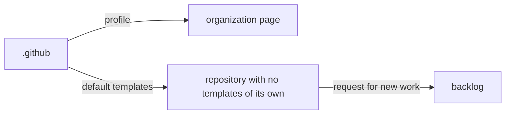

# .github

The organization's defaults. GitHub reads this repository for two things:

| Path | What it does |
| --- | --- |
| `profile/README.md` | The organization profile shown on the organization's page: what the studio is and its repositories grouped by kind (company, platform, product) |
| `.github/ISSUE_TEMPLATE/` | The default issue templates: a task form for the repository at hand, and a link that sends requests for new work to `backlog` |
| `.github/pull_request_template.md` | The default pull request template: summary, linked issue, evidence |
| `identity.json` | The identity file: the studio name, the organization and the domain, in one place, so a rename touches one file |

A repository that has its own issue templates or pull request template uses those instead; these defaults apply only where a repository has none.

