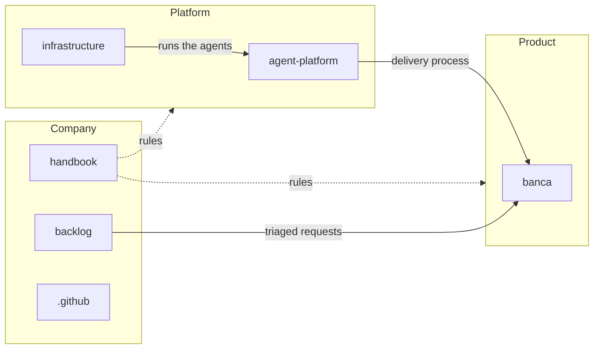

A software studio run by one founder and a team of AI agents. The founder decides what gets built; agents decide how, and every change lands as a reviewed pull request.

## Company

How the studio works.

- [handbook](https://github.com/zinski-dev/handbook) — decision records, policies, runbooks and conventions
- [backlog](https://github.com/zinski-dev/backlog) — the inbox where every request enters, and the priority queue
- [.github](https://github.com/zinski-dev/.github) — this profile and the default issue and pull request templates

## Platform

The machinery that builds the products.

- [agent-platform](https://github.com/zinski-dev/agent-platform) — the plugins that carry the delivery process: agents, skills, hooks and rules
- [infrastructure](https://github.com/zinski-dev/infrastructure) — the hosts as code: provisioning, network and runners

## Product

What gets delivered.

- [banca](https://github.com/zinski-dev/banca) — a point-of-sale product

